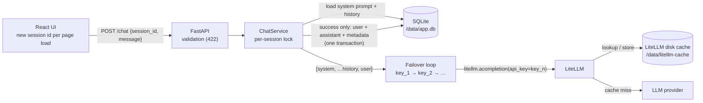

# Lyftr AI — Intelligent LLM Chat

A full-stack, multi-turn LLM chatbot with **automatic API-key failover**, **LiteLLM response caching** and **per-request token tracking**.

- **Backend:** Python 3.12 · FastAPI · LiteLLM 1.108.5 · SQLite (stdlib `sqlite3`)
- **Frontend:** React 19 · Vite 8 · TypeScript · Tailwind CSS 4 · Lucide icons
- **Infra:** multi-stage Docker images · Docker Compose with a named `/data` volume · Makefile

```
lyftr-ai/
├── backend/            FastAPI app (app/), pytest suite (tests/), Dockerfile
├── frontend/           React + Vite app (src/), nginx config, Dockerfile
├── docker-compose.yml  backend :8000 + frontend :3000 + named volume sqlite_data -> /data
├── Makefile            make up / down / logs / test / clean
├── render.yaml         Render Blueprint (backend with persistent disk + static frontend)
├── .env.example        every configuration variable, with placeholders
└── README.md
```

---

## 1. Live URLs

| Tier | URL |
|---|---|
| Frontend | https://lyftr-ai-12sohamverma.onrender.com |
| Backend | https://lyftr-ai-12sohamverma-api.onrender.com (health: https://lyftr-ai-12sohamverma-api.onrender.com/health) |

Both run on Render's free tier. The backend sleeps after 15 minutes idle, so the **first request after a pause can take about a minute** while it wakes up. Open the health URL first if the UI shows "Offline".

Verified against the live backend: health 200; live call then the same first message in a new session answered from `LLM_CACHE` (3 ms, identical reply and tokens, `key_id: null`); `X-Simulate-Failure: key_1=429` and `key_1=500` answered by `key_2` with `fallback_attempts: 1`; `*=429` returned 503 `{"detail":"all providers unavailable"}` with nothing stored (history 404); empty message returned 422.

### Deploying (Render Blueprint)

The repository contains a [`render.yaml`](render.yaml) that creates both services:

1. Push the repository to GitHub (public).
2. In Render: **New → Blueprint** → select the repository. Render creates
   - `lyftr-ai-12sohamverma-api`: the backend, built from `backend/Dockerfile` and run as a Docker web service.
   - `lyftr-ai-12sohamverma`: the frontend, a static site built with `npm ci && npm run build`.
3. When prompted, enter the secret / environment-specific values:

   | Service | Variable | Value |
   |---|---|---|
   | backend | `LLM_API_KEYS` | `key_one,key_two` (two or more real keys) |
   | backend | `ALLOWED_ORIGINS` | the frontend URL, e.g. `https://lyftr-ai-12sohamverma.onrender.com` |
   | frontend | `VITE_API_BASE_URL` | the backend URL, e.g. `https://lyftr-ai-12sohamverma-api.onrender.com` |

   `ENABLE_FAILURE_SIMULATION=true`, `DATABASE_URL=sqlite:////data/app.db` and the model are already set in the Blueprint.
4. If Render assigns different URLs than expected, update the two variables and redeploy. The frontend must be **rebuilt**, because Vite bakes `VITE_API_BASE_URL` into the bundle.
5. Verify: `curl <backend-url>/health` → `{"status":"ok","keys_configured":2,"cache_enabled":true,"model":"gemini/gemini-3.5-flash-lite"}`, then run the commands from [section 4](#4-verification-how-to-see-failover-cache-hits-and-per-message-token-usage) against the backend URL.

**Hosting plan.** The deployed backend runs on Render's **free** instance type, which has two limitations:

- **No persistent disk.** The SQLite file and the LiteLLM disk cache under `/data` are kept while the instance runs, but are reset when it restarts or is redeployed.
- **Sleeps after 15 minutes idle.** The first request after that waits roughly a minute for a cold start.

Within a running instance, history, multi-turn memory, caching and failover all behave as documented. For durable storage, switch the backend to `plan: starter` and uncomment the `disk:` block in `render.yaml`, which mounts a persistent disk at `/data`; no code changes are needed. Locally, Docker Compose always uses the persistent named volume.

---

## 2. Run locally: with Docker and without

### Prerequisites

- Docker with Compose v2.24+ (Docker Desktop on macOS/Windows) and `make`
- **Two LLM API keys** for the same provider. Free Google AI Studio (Gemini) keys work with the default model; any [LiteLLM-supported provider](https://docs.litellm.ai/docs/providers) works by changing `LLM_MODEL`.

### With Docker (recommended)

```bash
git clone <your-fork-url> lyftr-ai && cd lyftr-ai
cp .env.example .env
# edit .env:  LLM_API_KEYS=<first_key>,<second_key>

make up        # builds both images and starts the stack in the background
```

| | URL |
|---|---|
| Frontend | http://localhost:3000 |
| Backend | http://localhost:8000 (e.g. http://localhost:8000/health) |

Other commands:

```bash
make logs      # follow logs
make ps        # container status
make down      # stop the stack — the SQLite volume is kept
make test      # run the backend tests in a throwaway python:3.12 container (no keys/credits needed)
make clean     # stop AND delete the volume (history + cache) — destructive
```

History survives `make down && make up`, container restarts and image rebuilds because the database lives on the named volume `sqlite_data` (mounted at `/data`). Only `make clean` (`docker compose down -v`) removes it.

> **Windows without `make`:** `docker compose up --build -d` and `docker compose down` are exactly what `make up` / `make down` run.

### Without Docker

Backend (Python 3.11+):

```bash
cd backend
python -m venv .venv
source .venv/bin/activate            # Windows: .venv\Scripts\activate
pip install -r requirements-dev.txt

# Settings are read from environment variables or ../.env.
# Use a local database path instead of the container path /data/app.db:
export DATABASE_URL=sqlite:///./data/app.db        # PowerShell: $env:DATABASE_URL="sqlite:///./data/app.db"
export CACHE_DIR=./data/litellm-cache
uvicorn app.main:app --reload --port 8000

python -m pytest -v                  # tests (no network, no API keys)
```

Frontend (Node 20.19+ or 22.12+):

```bash
cd frontend
npm ci
npm run dev                          # http://localhost:3000, talks to VITE_API_BASE_URL (default http://localhost:8000)
npm run build                        # type-check + production bundle in dist/
```

### Configuration

All configuration is through environment variables (see [`.env.example`](.env.example)):

| Variable | Default | Meaning |
|---|---|---|
| `LLM_API_KEYS` | — | **Required.** Comma-separated key pool, at least 2. Ids are `key_1`, `key_2`, … in this order. Blank entries, duplicates and placeholders (`your_...`) are ignored. |
| `DATABASE_URL` | `sqlite:///./data/app.db` | SQLite location. Docker always uses `sqlite:////data/app.db`. |
| `ALLOWED_ORIGINS` | `http://localhost:3000` | Comma-separated CORS origins (the frontend URL in production). |
| `ENABLE_FAILURE_SIMULATION` | `false` | `true` enables the `X-Simulate-Failure` header (on in `.env.example`, Compose and Render). |
| `LLM_MODEL` | `gemini/gemini-3.5-flash-lite` | Any LiteLLM model id. All keys must belong to this provider. |
| `LLM_API_BASE` | empty | Optional custom endpoint (OpenAI-compatible gateways, Azure, local servers). |
| `LLM_TIMEOUT_SECONDS` | `30` | Per-key provider timeout; a timeout counts as a failure and the next key is tried. |
| `LLM_MAX_TOKENS` | `1024` | Upper bound for reply length (`0` = provider default). |
| `DEFAULT_SYSTEM_PROMPT` | `You are Lyftr AI, …` | Used when a session has no `system_prompt` override. |
| `CACHE_ENABLED` | `true` | LiteLLM response cache on/off (`/health` reports 503 when off). |
| `CACHE_TYPE` | `disk` | `disk` (persists on `/data`) or `local` (in-memory). |
| `CACHE_DIR` | `<db dir>/litellm-cache` | Disk-cache directory. |
| `LOG_LEVEL` | `INFO` | Python log level. |
| `VITE_API_BASE_URL` | `http://localhost:8000` | **Frontend build time.** Public backend URL. Never put secrets in `VITE_*` variables. |

---

## 3. Design decisions: key fallback, caching, SQLite session storage

### Architecture



```
backend/app/
├── main.py                    3 routes, CORS, app factory, lifespan (schema + cache setup)
├── config.py                  env settings, key-pool parsing (key_1, key_2, …), SQLite URL parsing
├── database.py / models.py    sqlite3 persistence, schema (messages + sessions)
├── schemas.py                 Pydantic request/response contract
├── services/
│   ├── chat_service.py        orchestration: history → LLM → metadata → persist
│   ├── failover_service.py    ordered key failover, error classification, X-Simulate-Failure
│   ├── litellm_service.py     the only place that calls the provider (litellm.acompletion)
│   └── cache_service.py       LiteLLM Cache setup + cache-hit detection
└── utils/
    ├── token_utils.py         usage extraction (provider-reported; tokenizer fallback)
    └── error_handlers.py      every error → JSON {"detail": …}
```

### Key pool and automatic fallback

- `LLM_API_KEYS` is parsed once into ordered, immutable `ApiKey(key_id, secret)` objects. The secret is excluded from `repr()`, and only the `key_id` ever appears in responses or logs.
- For each request, keys are tried **in order**. Each attempt is one `litellm.acompletion(...)` call with that key, and LiteLLM's own retries are disabled (`num_retries=0`, `max_retries=0`). The first success wins:
  - `key_id` is the key that answered.
  - `fallback_attempts` is the number of keys that failed before it.
- A failure moves on to the next key when it is retryable. Classification uses LiteLLM's typed exceptions, the HTTP status, and the message (providers report quota differently):

  | Fail over to next key | Stop immediately |
  |---|---|
  | 429 / `RateLimitError`, **quota** (`insufficient_quota`, `RESOURCE_EXHAUSTED`, "quota", "billing", whatever the status), 500, 502, 503 and any other 5xx, timeouts, connection errors, 401/403 (revoked or invalid key) | request-level errors such as 400 bad request, context-window exceeded, content policy. Another key would fail the same way, so the API returns `502 {"detail": "the model provider rejected this request"}`. |

- If every key fails, the API returns **`503 {"detail": "all providers unavailable"}`**. Provider messages and stack traces are never returned; logs record only key id, exception type and status.
- **Why an explicit ordered loop instead of `litellm.Router`?** The Router has two behaviours that conflict with the contract:
  - It puts failing deployments into a shared cooldown that outlives the request, so a simulated failure would leak into later requests.
  - Its routing strategies (for example shuffle) make the answering key non-deterministic.

  The assignment requires per-request simulation and exact `key_id` / `fallback_attempts` values. LiteLLM is still the only provider client: it does provider abstraction, error mapping, usage reporting and caching. The loop only decides which key to try next.
- **`X-Simulate-Failure`**, honoured only when `ENABLE_FAILURE_SIMULATION=true`:
  - Accepts `key_1=429`, `key_1=429,key_2=500` and `*=429`. Statuses are 429/500/502/503, and an explicit entry overrides `*`.
  - A listed key raises the **same LiteLLM exception class** a real provider error would (`RateLimitError`, `InternalServerError`, `BadGatewayError`, `ServiceUnavailableError`). Simulated and real failures therefore go through identical failover code.
  - The effect lasts for that request only; nothing is stored or disabled.
  - Unknown key ids or unsupported statuses get a `422` with a readable `detail`.
  - Simulated requests **bypass the cache** for both reads and writes (`no-cache` / `no-store`). Otherwise `key_1=429` could be answered from cache and never exercise a key, and `*=429` might not return 503.

### Response caching (LiteLLM built-in)

- `litellm.cache = Cache(type="disk", disk_cache_dir=/data/litellm-cache)` is LiteLLM's own cache. It sits on the same volume as SQLite, so it survives restarts. `CACHE_TYPE=local` switches to LiteLLM's in-memory cache.
- **Cache key = model + full message list.** I checked this in the LiteLLM 1.108.5 source (`Cache.get_cache_key`): the key is a SHA-256 over the LLM parameters that are present. Here those are `model`, `messages` (system prompt, history and new message) and the constant `max_tokens`.
  - `api_key`, `api_base`, timeouts and the session id are **not** in the key. The same first message in a new session therefore hits the cache, regardless of which key produced the original answer.
  - A different message, system prompt or history produces a different key, so it can never come from cache.
- **Cache-hit detection is LiteLLM's own flag.** LiteLLM marks replayed responses with `response._hidden_params["cache_hit"] = True`, which maps to `resolution_source: "LLM_CACHE"`, `key_id: null` and `fallback_attempts: 0`. The cached response replays its original `usage`, so the original token counts are reported.
- Two LiteLLM details had to be handled (found while verifying, documented in code):
  1. LiteLLM writes the cache in a background task. An identical request sent milliseconds later (an automated grader, say) could race that write. After a live answer the backend therefore waits briefly for LiteLLM's own pending write tasks (`cache_service.flush_pending_writes`).
  2. In 1.108.x, replaying a cache hit imports a few LiteLLM proxy modules that need `orjson` and `soundfile`. Without them every hit silently fails and becomes a live call. Both packages are pinned in `requirements.txt` instead of pulling in the whole `litellm[proxy]` extra. Those modules are also pre-imported at startup so the *first* hit is as fast as later ones.
- Result (real Gemini, Docker): live call 2404 ms, then the identical first message in a new session returned `LLM_CACHE` in **7 ms** with identical text and token counts.

### SQLite session storage

- `DATABASE_URL=sqlite:////data/app.db`. The schema is created on startup (`CREATE TABLE IF NOT EXISTS`):
  - **`messages`**: exactly the required columns, plus an index on `(session_id, id)`.
  - **`sessions`**: `session_id`, `system_prompt`, `created_at`. It stores each session's system-prompt override, which is never returned by the history endpoint.
- **Writes happen only after success.** The user message, the assistant reply (with its metadata JSON) and, on a session's first turn, the session row are written in **one transaction** after the LLM call succeeds. Failures (422, 502, 503) never touch the database, and an unknown session id simply starts a new session.
- **Concurrency:**
  - WAL journal mode and a busy timeout let readers proceed while a write commits.
  - A process-wide write lock serialises writes.
  - A per-session `asyncio.Lock` processes turns of the same session one after another, so each turn sees the previous one.
  - The backend runs as one Uvicorn worker on purpose, because SQLite and those locks live in one process.
- Timestamps are server time in ISO-8601 with an explicit UTC offset.

### Session management and multi-turn context

- The frontend generates a new `crypto.randomUUID()` session id on **every page load**. It falls back to `crypto.getRandomValues` outside secure contexts. The id lives only in React state and is never restored from storage. **New chat** starts another session within the same page.
- The client sends **only the new message**. The backend rebuilds the context from SQLite every turn as `[system prompt, ...stored history, new message]`.
- `system_prompt` (optional): a non-blank value becomes the session's override from that turn on and is persisted. Blank or absent means the stored override, or failing that `DEFAULT_SYSTEM_PROMPT`.

### Metadata generation

| Field | Source |
|---|---|
| `resolution_source` | LiteLLM's cache-hit flag |
| `model` | the LiteLLM model string that was called (e.g. `gemini/gemini-3.5-flash-lite`) |
| `latency_ms` | integer, `time.perf_counter()` from the moment the request reaches the handler until the reply is ready (before persistence) |
| `input_tokens` / `output_tokens` | provider-reported `usage.prompt_tokens` / `usage.completion_tokens` **for this request only**. If a provider ever omits usage, `litellm.token_counter` estimates it and the estimate is logged as such. |
| `key_id` / `fallback_attempts` | the failover loop (`null` / `0` on cache hits) |

### Security notes

- Keys live only in `.env` (git-ignored) or platform secrets. They never appear in responses, logs, the frontend bundle or the repository.
- CORS is restricted to `ALLOWED_ORIGINS`, and only `Content-Type` and `X-Simulate-Failure` are allowed as request headers.
- Swagger, ReDoc and OpenAPI routes are disabled, so the public surface is exactly the three endpoints.
- Every error is JSON with a `detail` field, including unexpected 500s, which a middleware returns *inside* CORS so the browser can still read them. 422 responses do not echo the submitted input.
- The backend image runs Uvicorn as an unprivileged `app` user. The entrypoint briefly runs as root only to `chown` a platform-mounted `/data` disk, then drops privileges with `setpriv`. The frontend is served by `nginx-unprivileged`.
- `LITELLM_MODE=PRODUCTION` stops LiteLLM from auto-loading a stray `.env` file, so `Settings` is the single source of configuration.

### Known limitations

- History is sent in full on each turn. Very long sessions could exceed the model's context window; the provider's 400 is then returned as a clean 502. Trimming or summarising old turns would be the next step.
- Cache entries do not expire. A TTL is a one-line `Cache(ttl=...)` change if answers should be refreshed.

---

## 4. Verification: how to see failover, cache hits and per-message token usage

Set `B=http://localhost:8000` (or the deployed backend URL). Example outputs below are real responses from the Docker stack with two Gemini keys; replies and timings will vary.

### Health

```bash
curl -s $B/health
# {"status":"ok","keys_configured":2,"cache_enabled":true,"model":"gemini/gemini-3.5-flash-lite"}
# ("model" is an extra field — allowed by the contract — so the UI can show the active model up front.)
```

### Cache hit (same first message, new session)

```bash
curl -s -X POST $B/chat -H "Content-Type: application/json" \
  -d '{"session_id": "session-a", "message": "Explain artificial intelligence simply."}'
# "metadata": {"resolution_source":"LIVE_INFERENCE","model":"gemini/gemini-3.5-flash-lite",
#              "latency_ms":2404,"input_tokens":28,"output_tokens":18,"key_id":"key_1","fallback_attempts":0}

curl -s -X POST $B/chat -H "Content-Type: application/json" \
  -d '{"session_id": "session-b", "message": "Explain artificial intelligence simply."}'
# same "reply" text, and
# "metadata": {"resolution_source":"LLM_CACHE","model":"gemini/gemini-3.5-flash-lite",
#              "latency_ms":7,"input_tokens":28,"output_tokens":18,"key_id":null,"fallback_attempts":0}
```

The second request returns `LLM_CACHE` because model, system prompt and message list are identical. Its reply and token counts are identical, `key_id` is `null`, and latency is far lower. Change one word and it is `LIVE_INFERENCE` again. The cache also survives `docker compose restart backend`.

### Failover

```bash
# key_1 behaves as if rate-limited -> key_2 answers (HTTP 200, a real model answer)
curl -s -X POST $B/chat -H "Content-Type: application/json" \
  -H "X-Simulate-Failure: key_1=429" \
  -d '{"session_id": "failover-test", "message": "Explain how API failover works."}'
# "metadata": {"resolution_source":"LIVE_INFERENCE", ..., "key_id":"key_2","fallback_attempts":1}

# key_1 returns a 5xx -> key_2 answers
curl -s -X POST $B/chat -H "Content-Type: application/json" \
  -H "X-Simulate-Failure: key_1=500" \
  -d '{"session_id": "failover-test-2", "message": "Say ok."}'
# ... "key_id":"key_2","fallback_attempts":1

# every key fails -> 503, nothing stored
curl -s -i -X POST $B/chat -H "Content-Type: application/json" \
  -H "X-Simulate-Failure: *=429" \
  -d '{"session_id": "all-fail-test", "message": "This should fail because all keys are simulated as unavailable."}'
# HTTP/1.1 503 Service Unavailable
# {"detail":"all providers unavailable"}

curl -s $B/sessions/all-fail-test/messages
# {"detail":"session not found"}     <- the failed request was not added to history
```

`key_1=429,key_2=500` also returns 503. The backend logs show each step, for example `key_1 failed with RateLimitError (status=429) [simulated]; trying next key`. To show it in the UI, open the frontend with `?simulate=key_1%3D429` (or `?simulate=*%3D429`): every message then carries that header, and the reply metadata shows `key_2` with fallback 1 (or the readable 503 error).

Real (non-simulated) provider failures take the same path. During development the backend was also run against a local fake provider that returned genuine HTTP 429 / quota / 500 responses for `key_1`. In each case `key_2` answered with `fallback_attempts: 1`, and with both keys failing the API returned 503.

### Multi-turn memory and history

```bash
curl -s -X POST $B/chat -H "Content-Type: application/json" -d '{"session_id": "memory-1", "message": "My name is Soham."}'
curl -s -X POST $B/chat -H "Content-Type: application/json" -d '{"session_id": "memory-1", "message": "What is my name?"}'
# "reply": "Your name is Soham."

curl -s $B/sessions/memory-1/messages
# {"session_id":"memory-1","messages":[
#   {"role":"user","content":"My name is Soham."},
#   {"role":"assistant","content":"…","metadata":{"resolution_source":"LIVE_INFERENCE","input_tokens":23,"output_tokens":4,…}},
#   {"role":"user","content":"What is my name?"},
#   {"role":"assistant","content":"Your name is Soham.","metadata":{…,"input_tokens":34,"output_tokens":6,…}}]}

curl -s $B/sessions/does-not-exist/messages
# 404 {"detail":"session not found"}
```

### Optional system prompt

```bash
curl -s -X POST $B/chat -H "Content-Type: application/json" \
  -d '{"session_id": "pirate", "message": "What is 2+2?", "system_prompt": "Always answer like a pirate, one short sentence."}'
# "reply": "Shiver me timbers, two and two make four, ye scurvy dog!"
```

### Validation (422)

```bash
curl -s -X POST $B/chat -H "Content-Type: application/json" -d '{"session_id": "v", "message": "   "}'   # empty after trim
curl -s -X POST $B/chat -H "Content-Type: application/json" -d '{"message": "hi"}'                    # missing session_id
curl -s -X POST $B/chat -H "Content-Type: application/json" -d '{bad json'                            # malformed JSON
# all: HTTP 422 {"detail":[{"type":…,"loc":[…],"msg":…}]}
```

A message over 4000 characters after trimming is also a 422.

### Reading the token numbers

- `input_tokens` is everything sent **for this request**: system prompt, stored history and the new message. It grows from turn to turn as history grows (23 → 34 above), but it is never a running total of earlier requests.
- `output_tokens` covers this reply only.
- Two equal-length first messages in two new sessions report about the same `input_tokens`.
- A cache hit reports the usage stored with the cached response.

In the UI every assistant reply shows these values in one quiet line under the answer:
- source: green ⚡ `LIVE_INFERENCE` or violet 🗄 `LLM_CACHE`
- model
- latency (`812 ms`)
- `in` / `out` tokens
- the answering key
- the fallback count, shown only when a failover happened

### Automated tests

`make test`, or `cd backend && python -m pytest -v`, runs **80 tests**, mocked at the provider boundary through LiteLLM's own `mock_response`, so LiteLLM's real cache and exception types are exercised without network calls or API credits. They cover:

- **Health:** key count, placeholders, degraded state.
- **Validation:** every 422 case.
- **Token accounting:** per-request counts, not running totals.
- **Multi-turn and history:** context, session isolation, history order, 404 for unknown sessions, system-prompt persistence and hiding, persistence across app restarts.
- **Failover:** every failover status including quota and auth errors, `fallback_attempts` with 3 keys, 503 with nothing persisted.
- **Simulation header:** every header form, invalid headers, disabled mode, per-request scope.
- **Cache:** hits across sessions, cache keys that include the system prompt and history, hits faster than live calls, cache bypass for simulated requests, disk cache surviving a restart.
- **Routing and CORS:** CORS rules, disabled docs routes.

---

## 5. Setup Used: your editor and AI tools

- **Editor:** Visual Studio Code
- **AI assistant:** Claude Code (Anthropic) inside VS Code. It was used to inspect the assignment, implement backend and frontend, write tests, debug LiteLLM caching behaviour and write this README; every step was run and checked locally.
- **Languages / runtimes:** Python 3.13 locally (Python 3.12 in the Docker image), Node.js 22
- **Backend:** FastAPI, Pydantic / pydantic-settings, LiteLLM, SQLite (`sqlite3`), Uvicorn, pytest
- **Frontend:** React, Vite, TypeScript, Tailwind CSS, Lucide React, react-markdown
- **Infra:** Docker Desktop, Docker Compose, GNU Make
- **LLM provider used for development:** Google Gemini API (`gemini/gemini-3.5-flash-lite`) with two API keys
- **Verification:** Playwright (headless Chromium), run outside the repository to check the UI contract (`data-testid`s, Enter-to-send, cleared input, errors, new session per page load) against the Docker stack

---

## 6. Bonus features (if any): what you added beyond the requirements and why

The interface is deliberately minimal and chat-first, in the style of ChatGPT/Gemini: a sidebar with chats, a centred conversation and one composer. Everything the assignment asks for is on screen: multi-turn chat, per-reply metadata, the optional system prompt, and readable errors. Extras were kept only where they help use or verify the app.

- **Voice Mode (spoken conversation).** The waveform button in the composer opens a hands-free mode with an animated orb and a live waveform driven by the real microphone level.
  - **How a turn works:** you speak and see a live transcript. After about 1.3 s of silence the turn is sent through the **same `POST /chat` request path** as typed messages, so session memory, the system prompt and the cache all apply. The reply is read aloud with the browser's speech synthesis, then it listens again.
  - **Controls:** mute, interrupt (Space) and end call (Esc).
  - **In the chat:** voice turns appear in the normal chat with their full metadata, tagged "Voice".
  - **Limits:** it uses the Web Speech API, so it needs Chrome, Edge or Safari. Interrupting stops the spoken answer, but a request that already reached the server still completes and is stored.
- **Failover demo from the browser, with no extra UI.** Open the frontend with `?simulate=key_1=429` (URL-encoded: `?simulate=key_1%3D429`), or `?simulate=*%3D429`. Every message then carries that `X-Simulate-Failure` header, a small removable chip shows it is active, and the reply metadata shows `key_2` with a highlighted fallback count, or the readable 503 error.
- **Key and fallback in the metadata line.** Next to the required source, model, latency and token counts, each reply shows the key that answered, and the fallback count when a failover happened.
- **Chats within the tab.** "New chat" starts another session without reloading, and each chat's ⋯ menu copies its session id or opens `GET /sessions/{id}/messages`. A reload still starts a fresh session, as required.
- **Connection line from `/health`.** The bottom of the sidebar shows connected, degraded or offline, plus the key count and cache state, so configuration problems are visible at a glance.
- **Retry on errors.** A failed message is marked "Not delivered" and gets a Retry button.
- **Markdown rendering, copy button, light/dark theme, mobile drawer, Alt + N for a new chat.**
- **Persistent disk cache.** Locally, the LiteLLM cache lives on the `/data` volume, so cache hits survive restarts.
- **Robustness beyond the spec.**
  - Revoked or invalid keys (401/403) and timeouts also trigger failover.
  - Pools of three or more keys are supported.
  - Requests within a session are processed one at a time.
  - Unexpected errors still return JSON with CORS headers.
  - A degraded `/health` logs its reason once.
- **`make test`.** Runs the backend suite in a throwaway container, so reviewers don't need a local Python setup.
